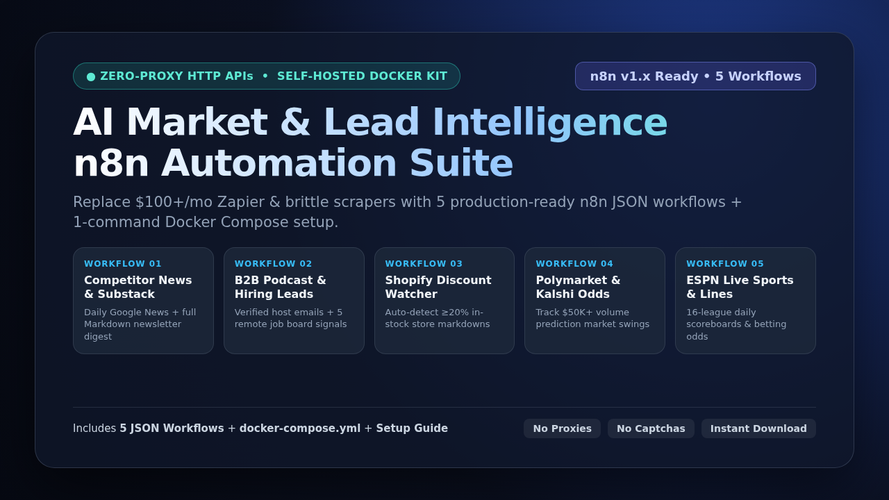

# Zero-Proxy Remote MCP Servers & Free n8n Automation Templates

Production-grade **Remote MCP Servers (Streamable HTTP)** and **plug-and-play n8n automation workflows** powered by official public JSON/RSS APIs — built for **Claude Desktop, Claude Code, Cursor, Windsurf, OpenAI Agents, Clay, and n8n**.

- **Zero headless browsers & zero residential proxies** (sub-second responses, 256 MB lightweight containers)
- **Native Streamable HTTP MCP (`/mcp`)** — no local Docker or Node.js setup required
- **Live Interactive Config Generator & 2026 MoR Fee Calculator**: https://shawn1905.github.io/indie-builder-toolkit/

---

## Live Remote MCP Servers (Streamable HTTP)

| MCP Server | Category | Tools Included | Remote MCP Endpoint (`/mcp`) | Apify Store |
| --- | --- | --- | --- | --- |
| **Google News Real-Time MCP** | News & Research | `search_google_news`, `get_topic_news`, `get_top_headlines` (50+ countries, `1h`/`1d`/`7d`/`30d`) | `https://shawn1905--google-news-rss-mcp-server.apify.actor/mcp` | [View Listing](https://apify.com/shawn1905/google-news-rss-mcp-server) |
| **ESPN Sports Data & Odds MCP** | Sports & Odds | 10 tools across 16 leagues (NFL, NBA, MLB, NHL, EPL, UCL, UFC, F1): live scores, boxscores, odds, injuries, standings, rosters, schedules | `https://shawn1905--espn-sports-mcp-server.apify.actor/mcp` | [View Listing](https://apify.com/shawn1905/espn-sports-mcp-server) |
| **Remote Jobs & B2B Hiring Leads MCP** | Jobs & Lead Gen | Deduplicated live remote jobs + active hiring companies across 5 official boards (Himalayas, RemoteOK, Remotive, Jobicy, Arbeitnow) | `https://shawn1905--remote-jobs-intelligence-hub.apify.actor/mcp` | [View Listing](https://apify.com/shawn1905/remote-jobs-intelligence-hub) |
| **Polymarket & Kalshi Odds MCP** | Finance & Markets | `get_trending_markets`, `search_markets`, `compare_venues` (live implied probabilities, bid/ask spreads, 24h volume) | `https://shawn1905--prediction-markets-mcp-server.apify.actor/mcp` | [View Listing](https://apify.com/shawn1905/prediction-markets-mcp-server) |
| **Substack Intelligence Scraper** | Newsletters & RAG | Clean LLM-ready Markdown posts, nested comments, custom domains & 35 category leaderboards (available via `mcp.apify.com`) | `https://mcp.apify.com` | [View Listing](https://apify.com/shawn1905/substack-intelligence-scraper) |

---

## Quick Setup (Claude Desktop / Cursor / Windsurf)

Add any server to your `claude_desktop_config.json` or `.cursor/mcp.json` (or use the [1-click Config Generator](https://shawn1905.github.io/indie-builder-toolkit/)):

```json
{
  "mcpServers": {
    "google-news": {
      "url": "https://shawn1905--google-news-rss-mcp-server.apify.actor/mcp",
      "headers": {
        "Authorization": "Bearer YOUR_APIFY_TOKEN"
      }
    },
    "espn-sports": {
      "url": "https://shawn1905--espn-sports-mcp-server.apify.actor/mcp",
      "headers": {
        "Authorization": "Bearer YOUR_APIFY_TOKEN"
      }
    },
    "remote-jobs": {
      "url": "https://shawn1905--remote-jobs-intelligence-hub.apify.actor/mcp",
      "headers": {
        "Authorization": "Bearer YOUR_APIFY_TOKEN"
      }
    },
    "prediction-markets": {
      "url": "https://shawn1905--prediction-markets-mcp-server.apify.actor/mcp",
      "headers": {
        "Authorization": "Bearer YOUR_APIFY_TOKEN"
      }
    }
  }
}
```

Get a free Apify API token (includes $5/month free platform credit) at [console.apify.com/settings/integrations](https://console.apify.com/settings/integrations).

---

## Free Importable n8n Workflow Templates

Ready to import directly into self-hosted or cloud **n8n** (`Workflows → Import from File`):

1. [`n8n-templates/daily-competitor-news-substack-digest.json`](./n8n-templates/daily-competitor-news-substack-digest.json) — Automated daily morning briefing combining 24h Google News + clean Markdown Substack competitor posts.
2. [`n8n-templates/b2b-podcast-and-remote-hiring-leads.json`](./n8n-templates/b2b-podcast-and-remote-hiring-leads.json) — Weekly B2B lead pipeline pulling active companies hiring high-salary remote engineers ($120k+) + podcast leads.

### Want All 5 Production n8n Workflows + 1-Command Docker Setup?

[](https://fengyetnot.gumroad.com/l/skuqx)

Get the complete **AI Market & Lead Intelligence — 5 Production n8n Workflows + Docker Kit ($19)** on Gumroad (includes all 5 ready-to-import workflows for News/Substack, B2B Podcast & Hiring Leads, Shopify Discount Watcher, Polymarket/Kalshi Odds, ESPN Live Lines + `docker-compose.yml` + `.env.example` + 3-min setup guide):

👉 **[Get the Complete 5-in-1 n8n + Docker Kit on Gumroad ($19)](https://fengyetnot.gumroad.com/l/skuqx)**

---

## License

MIT License — free to use, fork, and adapt the templates and configs.
